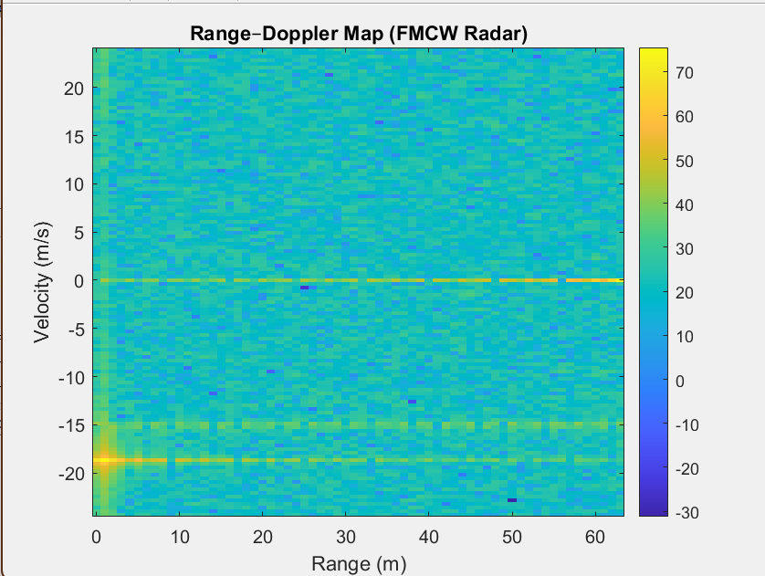
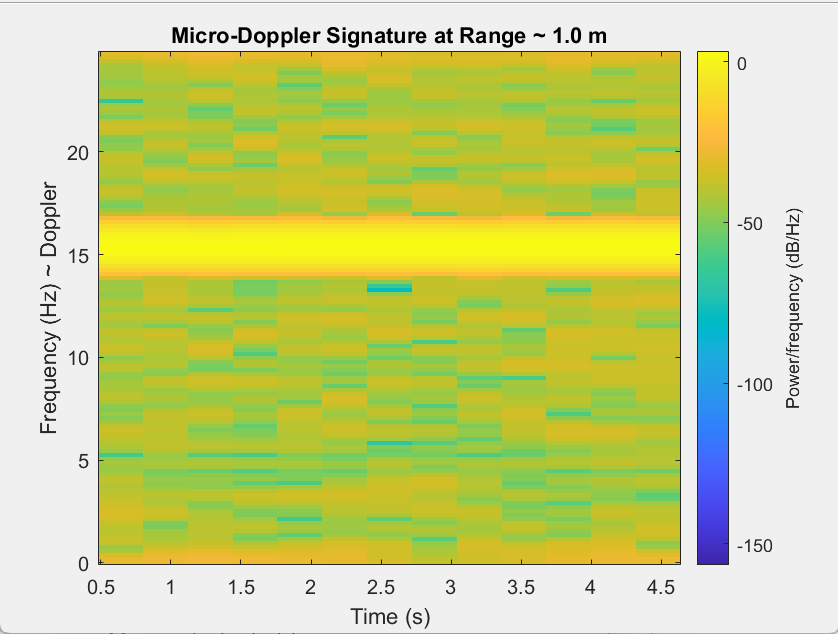
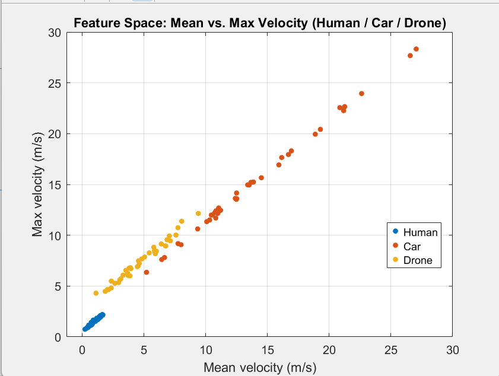

# FMCW-Radar-ML-Classification

## 📘 Overview
This project implements a **software-only FMCW radar simulator** in **MATLAB** and combines it with a simple **machine learning classifier** to distinguish between three target types: **Human**, **Car**, and **Drone** using their Doppler / micro-Doppler signatures.

The project is designed as a compact RF + ML portfolio piece showcasing radar signal processing, feature engineering, and classification — all done in MATLAB.

---

## ⚙️ Features

### 🔹 FMCW Radar Signal Chain
- 77 GHz carrier frequency (typical automotive radar band)  
- 150 MHz sweep bandwidth  
- Linear FMCW chirp generation  
- Range FFT (fast-time processing)  
- Doppler FFT (slow-time processing)  
- Range–Doppler Map visualisation  
- Micro-Doppler-like spectrogram at a selected range bin  

### 🔹 Machine Learning Classification
- Synthetic classes: **Human**, **Car**, **Drone**  
- Velocity profiles generated to mimic each class:
  - Human: low speed, strong micro-motion
  - Car: higher average speed, smoother profile
  - Drone: moderate speed with oscillatory hovering motion
- RF-inspired features extracted from velocity:
  - Mean velocity  
  - Standard deviation of velocity  
  - Maximum absolute velocity  
  - Mean absolute derivative of velocity  
- Multi-class SVM classifier (`fitcecoc`) trained and evaluated  
- Prints overall classification accuracy in the MATLAB command window  

---

## 🧩 File Summary

| File / Folder | Description |
|---------------|-------------|
| `Radar_ML_Simulation.m` | Main MATLAB script: FMCW radar simulation + ML classification |
| `q1.png` | Range–Doppler Map (Range vs Velocity) |
| `q2.png` | Micro-Doppler-like spectrogram at a chosen range bin |
| `q3.png` | Feature space scatter plot (Human / Car / Drone) |

---

## 🧪 Tools & Environment

- **MATLAB** (tested with R2024b; works with most recent versions)  
- Recommended Toolboxes:
  - **Signal Processing Toolbox**
  - **Statistics and Machine Learning Toolbox**

No external hardware is required — everything runs as a simulation.

---

## 📊 Results

### 1️⃣ Range–Doppler Map
The first figure shows the **Range–Doppler Map**, where each bright region corresponds to a simulated target at a particular range and radial velocity.

| Range–Doppler Map |
|-------------------|
|  |

---

### 2️⃣ Micro-Doppler-Like Signature
At the strongest range bin, the script extracts the slow-time signal and computes a **spectrogram**, giving a micro-Doppler-like signature that reflects the velocity variations of the target over time.

| Micro-Doppler Spectrogram |
|---------------------------|
|  |

---

### 3️⃣ ML Feature Space
The final figure shows the **feature space** (e.g., mean vs max velocity) with different classes labelled, giving intuition about how well the RF-inspired features separate Human, Car, and Drone motion.

| Feature Space (Human / Car / Drone) |
|-------------------------------------|
|  |

The script prints the **classification accuracy** in the MATLAB command window, giving a quick sense of how well the simple SVM model performs on the synthetic dataset.

---

## ▶️ How to Run

1. Open MATLAB.  
2. Add this project folder to the MATLAB path or set it as the **Current Folder**.  
3. Open `Radar_ML_Simulation.m`.  
4. Click **Run** (or press `F5`).  
5. Three figures will be generated:
   - Range–Doppler map  
   - Micro-Doppler spectrogram  
   - Feature space scatter  
6. Optionally, save the figures as `q1.png`, `q2.png`, `q3.png`.

---

## 📡 Applications

- Radar signal processing education and demos  
- RF + ML portfolio for automotive / sensing roles  
- Feature-engineering concepts for Doppler / micro-Doppler analysis  
- Baseline project for extending to real hardware or more advanced ML models  
